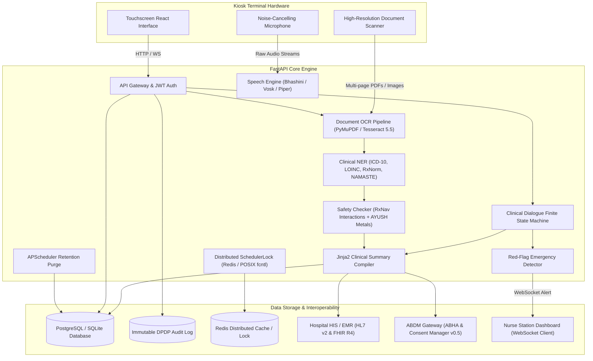
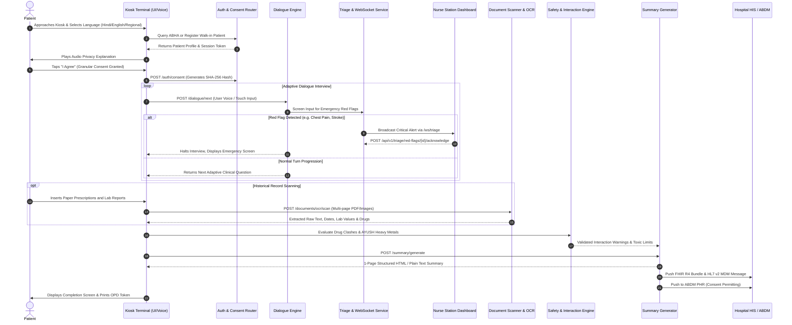
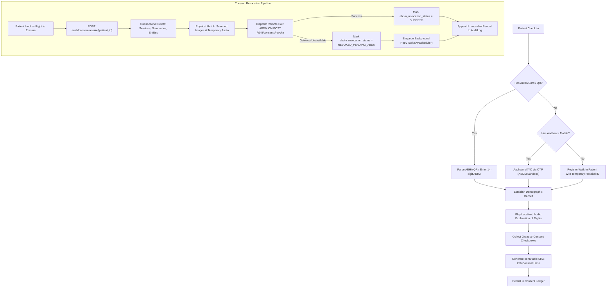
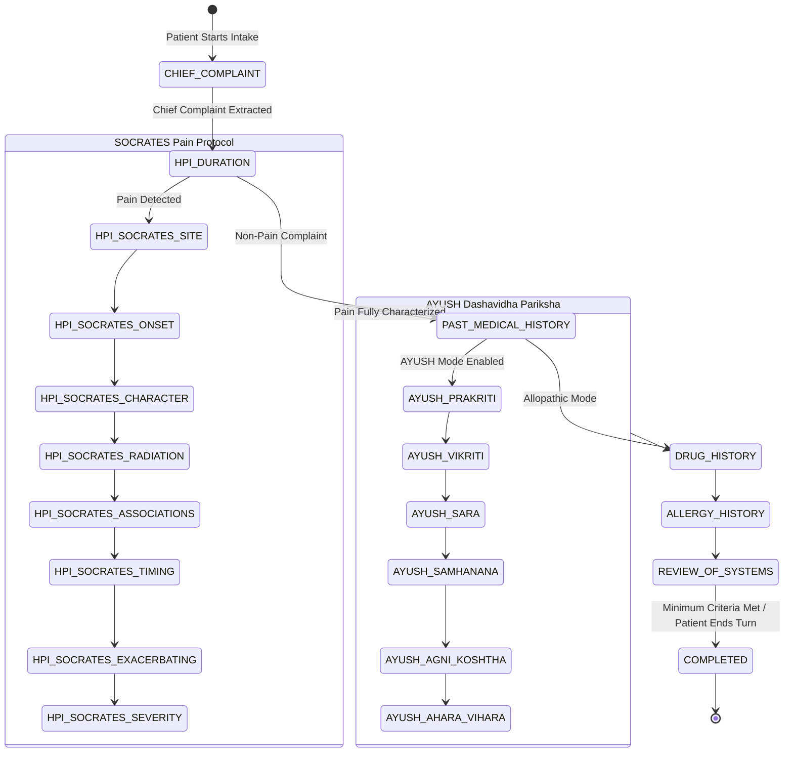
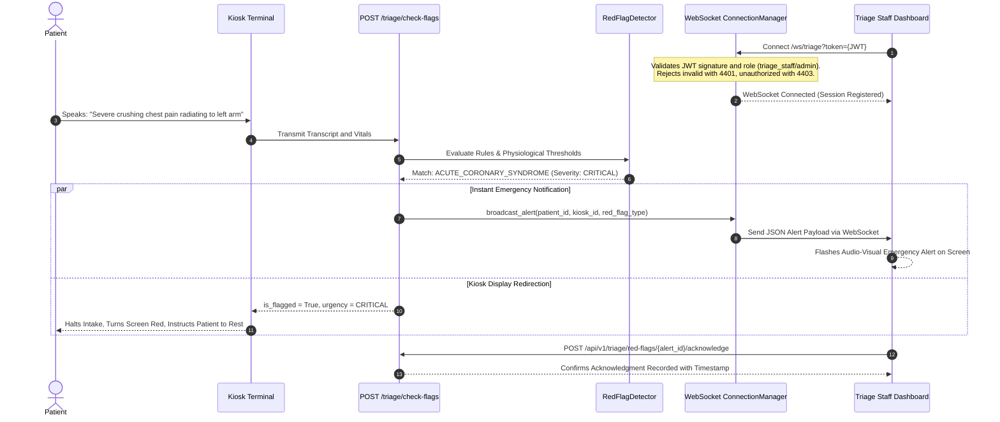
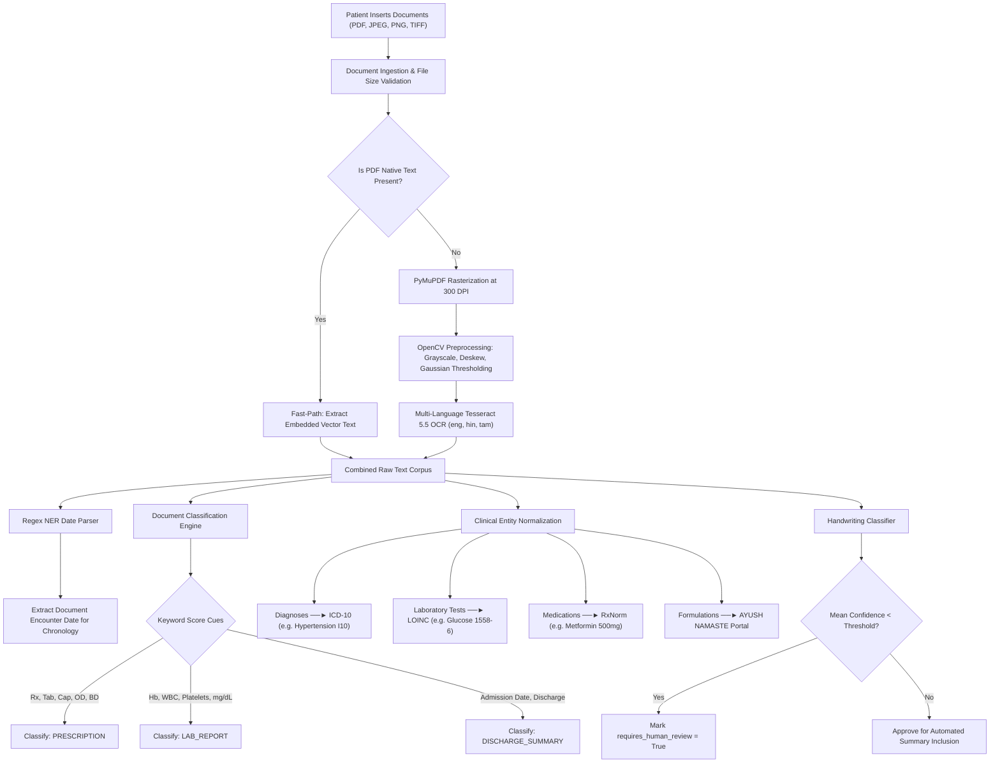
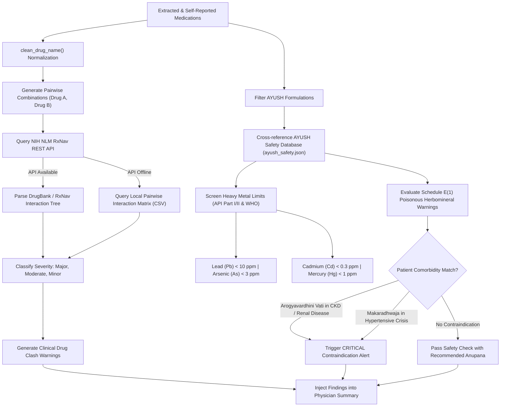
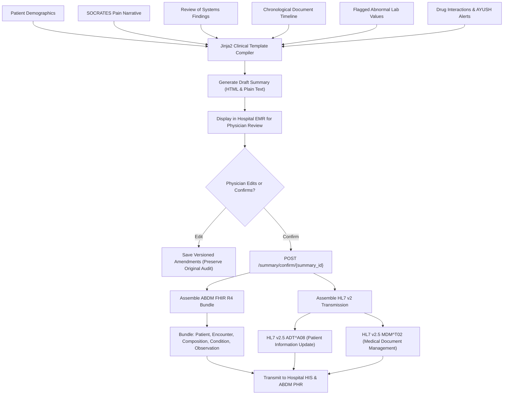
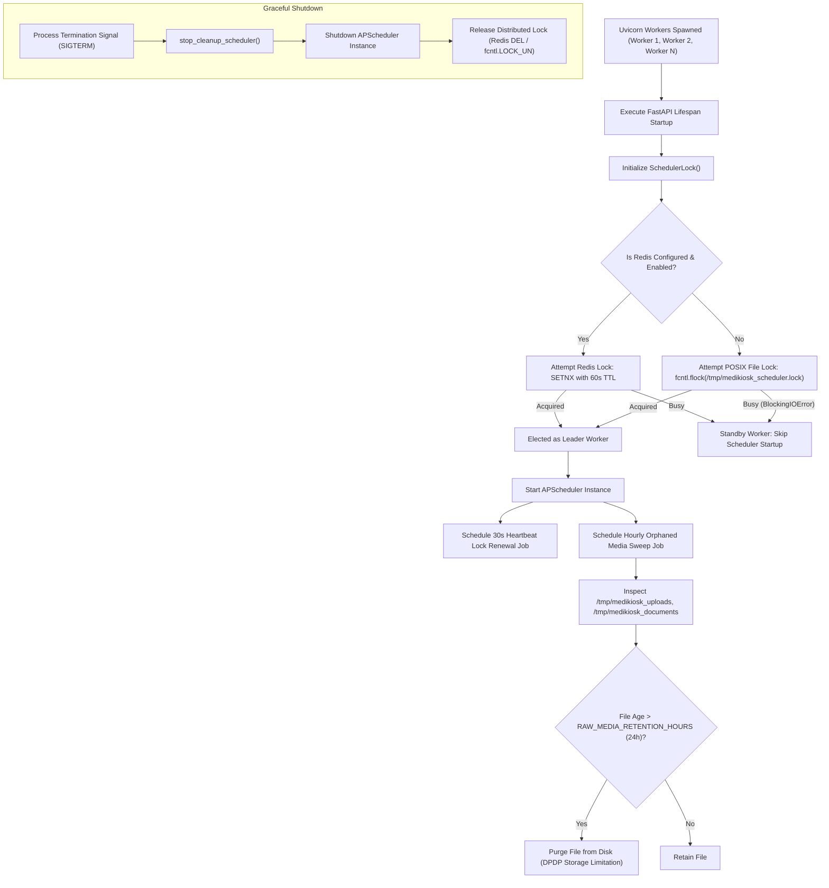
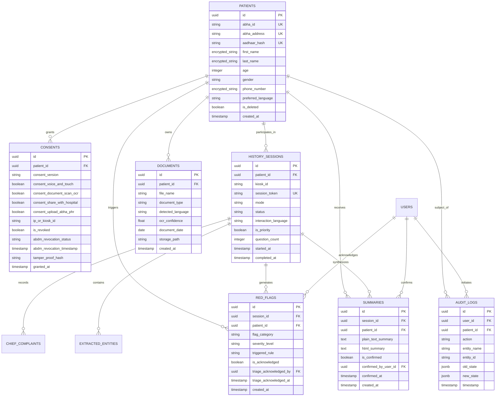

# MEDIKIOSK - TEAM selfNprove SIH 2026

AI-Powered Multilingual Patient Intake and Clinical Pre-Consultation Kiosk Platform for High-Volume Public Hospitals and AYUSH Healthcare Facilities.

---

## Table of Contents

1. [Executive Summary and Problem Statement](#1-executive-summary-and-problem-statement)
2. [Core Value Proposition and Impact](#2-core-value-proposition-and-impact)
3. [System Architecture and Technology Stack](#3-system-architecture-and-technology-stack)
4. [End-to-End Patient Intake Workflow](#4-end-to-end-patient-intake-workflow)
5. [Deep Dive into Functional Modules](#5-deep-dive-into-functional-modules)
   - [5.1 Module 1: Patient Identity, ABHA and DPDP Consent](#51-module-1-patient-identity-abha-and-dpdp-consent)
   - [5.2 Module 2: Multimodal Conversational History Engine](#52-module-2-multimodal-conversational-history-engine)
   - [5.3 Module 3: Real-Time Emergency Triage and Alerts](#53-module-3-real-time-emergency-triage-and-alerts)
   - [5.4 Module 4: Medical Document OCR and Clinical NER](#54-module-4-medical-document-ocr-and-clinical-ner)
   - [5.5 Module 5: Clinical Safety, Drug Interactions and AYUSH Toxicology](#55-module-5-clinical-safety-drug-interactions-and-ayush-toxicology)
   - [5.6 Module 6: Structured Summary Generation and EMR Interoperability](#56-module-6-structured-summary-generation-and-emr-interoperability)
   - [5.7 Module 7: Multi-Worker Distributed Scheduler and System Maintenance](#57-module-7-multi-worker-distributed-scheduler-and-system-maintenance)
6. [Database Schema and Data Models](#6-database-schema-and-data-models)
7. [Comprehensive API Endpoint Catalog](#7-comprehensive-api-endpoint-catalog)
8. [Installation and Deployment Guide](#8-installation-and-deployment-guide)
9. [Verification, Testing and Performance Benchmarks](#9-verification-testing-and-performance-benchmarks)
10. [Regulatory Compliance and Standards Alignment](#10-regulatory-compliance-and-standards-alignment)

---

## 1. Executive Summary and Problem Statement

### 1.1 The Healthcare Bottleneck in India
Public healthcare institutions in India, including premier tertiary centers such as the All India Institute of Medical Sciences (AIIMS) and the All India Institute of Ayurveda (AIIA), witness overwhelming outpatient volumes ranging between 4,000 and 10,000 patients every day. Consequently, physicians are constrained to consultation windows of merely 2 to 3 minutes per patient. Within this limited timeframe, doctors must perform multiple demanding cognitive tasks:
- Manually extract chief complaints and history of present illness.
- Decipher handwritten medical records and historical prescriptions.
- Inspect prior laboratory investigations for physiological abnormalities.
- Screen for contraindications and drug-drug interactions.
- Perform detailed domain-specific assessments, such as the Ayurvedic Dashavidha Pariksha.
- Formulate an accurate diagnosis, conduct physical examinations, and prescribe treatment.

This severe time constraint leads to under-elicited medical histories, missed comorbidities, adverse drug events, and extreme clinician burnout.

### 1.2 The MediKiosk Solution
MediKiosk is an automated, multimodal self-service kiosk deployed in hospital OPD waiting areas. Designed specifically for Indian demographics, it enables rural, urban, semi-literate, and elderly patients to independently record their complete medical history using voice and touch in their native language before entering the consultation room.

Furthermore, MediKiosk digitizes physical medical documents, extracts structured clinical entities (coded to ICD-10, LOINC, RxNorm, and NAMASTE standards), checks for dangerous drug interactions and heavy metal toxicity, and transmits a verified, single-page clinical summary directly to the physician's EMR interface.

---

## 2. Core Value Proposition and Impact

- **Time Reclamation for Physicians**: Reduces history-taking time by over 60%, allowing doctors to focus on examination and patient care.
- **Universal Accessibility**: Combines natural voice conversations (speech-to-text and text-to-speech in Hindi, English, and regional languages) with intuitive touch screen interfaces.
- **Clinical Safety and Decision Support**: Real-time cross-referencing against NIH RxNav drug interaction databases and WHO/API Ayurvedic heavy metal limits.
- **Emergency Triage**: Automated detection of critical red flags (e.g., myocardial infarction, stroke, hypertensive emergencies) with instantaneous WebSocket alerts to nurse stations.
- **National Ecosystem Integration**: Built from the ground up to integrate with the Ayushman Bharat Digital Mission (ABDM), supporting ABHA ID, Consent Manager v0.5, and FHIR R4 clinical bundles.
- **Full Regulatory Compliance**: Strict implementation of the Digital Personal Data Protection (DPDP) Act 2023, including cryptographic consent logs, granular permissions, and right-to-erasure cascade deletion.

---

## 3. System Architecture and Technology Stack

MediKiosk utilizes a decoupled, modern architecture optimized for high concurrency, low latency, and strict data security.



### Technology Stack Specifications
- **Runtime Environment**: Python 3.11+ (Certified on Python 3.14.5).
- **Web Framework**: FastAPI, Starlette, Uvicorn (ASGI async server).
- **Database Layer**: SQLAlchemy 2.0 (Declarative Mapped Columns, AsyncSession Local, PostgreSQL 16 / SQLite).
- **Speech Processing**: Bhashini ULCA Pipeline, Microsoft Edge Neural TTS (Swara / Neerja), Vosk offline Kaldi provider, Piper ONNX, espeak-ng, macOS native say synthesizer, pure-python audioop fallbacks.
- **Document Processing**: Tesseract 5.5.3 (Language packs: eng, hin, tam), PyMuPDF (fitz), Pillow, OpenCV.
- **Clinical Ontologies**: ScispaCy, Med7, ICD-10, LOINC, RxNorm, AYUSH NAMASTE.
- **Distributed Locking & Scheduling**: Redis, POSIX fcntl kernel locks, APScheduler 3.11+.
- **Frontend Layer**: React 18, TypeScript, Vite, Tailwind CSS, WebSockets.

---

## 4. End-to-End Patient Intake Workflow



---

## 5. Deep Dive into Functional Modules

### 5.1 Module 1: Patient Identity, ABHA and DPDP Consent

The Identity and Consent subsystem governs patient verification and legal data processing permissions.



Key Capabilities:
- **ABHA Lookup and Creation**: Direct integration with ABDM Milestone 1 workflows for identity verification.
- **Granular Consent**: Separate explicit opt-ins for voice intake, document scanning, hospital EMR sharing, and ABHA PHR sync.
- **DPDP Act 2023 Right to Erasure**: Endpoint `POST /auth/consent/revoke/{patient_id}` executes atomic cascade deletion of clinical data while retaining an anonymized cryptographic audit log.
- **Remote Revocation Propagation**: Communicates directly with the ABDM Consent Manager (CM v0.5) to invalidate national consent artifacts.

---

### 5.2 Module 2: Multimodal Conversational History Engine

The dialogue engine acts as an AI clinical interviewer following established medical frameworks.



Clinical Questioning Standards:
- **SOCRATES Framework**: Fully characterizes pain symptoms by Site, Onset, Character, Radiation, Associations, Timing, Exacerbating factors, and Severity (1 to 10 scale).
- **Review of Systems (ROS)**: Systematically screens cardiovascular, respiratory, gastrointestinal, and neurological systems.
- **Ayurvedic Dashavidha Pariksha**: Assesses Prakriti (body constitution), Vikriti (imbalance), Sara (tissue quality), Samhanana (body build), Agni (digestive fire), and Koshtha (bowel habits).

Speech Recognition (ASR) & Natural Neural Synthesis (TTS):
- **Studio-Quality Neural Voices**: Integrated Microsoft Neural TTS delivering natural human cadence, tone, and breath pauses:
  - Hindi: `hi-IN-SwaraNeural` (natural Indian female healthcare assistant).
  - English: `en-IN-NeerjaNeural` (natural Indian-accented clinical voice).
  - Regional Languages: Tamil (`ta-IN-PallaviNeural`), Telugu (`te-IN-ShrutiNeural`), Bengali (`bn-IN-TanishaaNeural`), Marathi (`mr-IN-AarohiNeural`), Gujarati (`gu-IN-DhwaniNeural`).
- **5-Tier Zero-Downtime Fallback Cascade**:
  1. Bhashini ULCA Speech Gateway (Government of India online models)
  2. Edge Neural TTS (Natural human voice synthesis)
  3. Piper ONNX Neural Voice Engine (Local deep learning models)
  4. espeak-ng Synthesizer (Ultra-lightweight Linux formant synthesis)
  5. macOS Native Synthesizer (`/usr/bin/say`) with Lekha / Samantha voices
- **Automatic Audio Normalization**: Converts all speech output to standard 16kHz 16-bit mono PCM WAV via ffmpeg.

---

### 5.3 Module 3: Real-Time Emergency Triage and Alerts

MediKiosk monitors incoming transcripts and vitals in real-time to intercept life-threatening emergencies.



Red Flag Criteria:
- **Cardiovascular**: Retrosternal pain radiating to left arm/jaw, diaphoresis, systolic blood pressure > 180 mmHg.
- **Neurological**: Sudden focal neurological deficits, slurred speech, facial droop, thunderclap headache.
- **Respiratory**: Severe stridor, respiratory rate > 30 breaths/min, SpO2 < 90%.
- **Trauma and Hemorrhage**: Uncontrolled external bleeding, hematemesis, acute rigid abdomen.

---

### 5.4 Module 4: Medical Document OCR and Clinical NER

The document digitization subsystem processes legacy paper records and extracts standardized clinical entities.



Key Extraction Pipelines:
- **Bilingual OCR**: Handles mixed-script documents containing English medical terms and Devanagari Hindi or Tamil text.
- **Abnormal Lab Flagging**: Identifies laboratory parameters outside biological reference intervals and highlights values in clinical reports.
- **Chronological Sorting**: Organizes multiple historical documents into a structured chronological timeline.

---

### 5.5 Module 5: Clinical Safety, Drug Interactions and AYUSH Toxicology

MediKiosk features an automated clinical decision support engine to prevent pharmaceutical and herbomineral adverse events.



Safety Database Specifications:
- **NIH RxNav Integration**: Real-time evaluation of dangerous drug combinations, such as `Aspirin + Warfarin` (severe hemorrhage risk) and `Metformin + Radiocontrast` (lactic acidosis risk).
- **AYUSH Toxicology Engine**: Cross-references Rasa Shastra Bhasmas (Parada, Gandhaka, Tamra, Lauha) against chronic disease contraindications.

---

### 5.6 Module 6: Structured Summary Generation and EMR Interoperability

Once intake is complete, the summary engine compiles a comprehensive document for clinical review.



Integration Standards:
- **HL7 FHIR R4**: Complies with the official ABDM Health Information Exchange specifications.
- **HL7 v2 MLLP Messaging**: Provides native compatibility with existing Indian hospital management systems (e.g., C-DAC e-Sushrut, NIC e-Hospital).
- **Physician Review Protocol**: Summaries remain in draft state until confirmed by a licensed medical practitioner.

---

### 5.7 Module 7: Multi-Worker Distributed Scheduler and System Maintenance

To ensure stability across multi-worker Uvicorn deployments, MediKiosk uses a distributed leader-election mechanism for background tasks.



Key Maintenance Features:
- **SchedulerLock**: Prevents duplicate execution of cleanup and synchronization jobs across clustered workers.
- **Automated Media Sweeping**: Enforces the DPDP Act storage limitation requirement by purging temporary voice recordings and unlinked images after 24 hours.
- **Data Authenticity Validation**: Runs automated integrity audits on startup to verify knowledge base files.

---

## 6. Database Schema and Data Models

The MediKiosk database contains 10 core relational tables implemented using SQLAlchemy 2.0.



Field Encryption Architecture:
Sensitive Personally Identifiable Information (PII) fields (e.g., patient names, phone numbers, and street addresses) use transparent AES-256 encryption via `EncryptedString` columns. Unencrypted raw Aadhaar numbers are never persisted; only peppered HMAC-SHA256 tokens are stored.

---

## 7. Comprehensive API Endpoint Catalog

The backend exposes 27 REST and WebSocket endpoints organized into functional route groups:

| Group | Method | Path | Summary / Description |
|---|---|---|---|
| **System** | `GET` | `/health` | Heartbeat endpoint reporting platform status and dataset integrity (`HEALTHY`/`DEGRADED`). |
| **Auth** | `POST` | `/auth/kiosk/token` | Issues a cryptographically signed JWT token for station terminal identity. |
| **Auth** | `POST` | `/auth/abha/search` | Searches for patient profiles using ABHA ID, ABHA address, or Aadhaar hash. |
| **Auth** | `POST` | `/auth/abha/create` | Issues a new ABHA identity via simulated/live Aadhaar eKYC OTP. |
| **Auth** | `POST` | `/auth/patient/register` | Registers walk-in patients lacking digital credentials with a temporary hospital ID. |
| **Auth** | `POST` | `/auth/consent` | Records granular DPDP consent along with a SHA-256 tamper-proof audit hash. |
| **Auth** | `GET` | `/auth/consent/{patient_id}` | Retrieves active unrevoked consent status for a specific patient. |
| **Auth** | `POST` | `/auth/consent/revoke/{patient_id}` | Right-to-erasure endpoint: purges intake data and propagates revocation to ABDM. |
| **Dialogue** | `POST` | `/dialogue/start` | Initializes a new history intake session in Allopathic or AYUSH mode. |
| **Dialogue** | `POST` | `/dialogue/next` | Ingests voice transcript/touch chip, evaluates red flags, and returns the next adaptive question. |
| **Speech** | `POST` | `/speech/asr` | Converts spoken audio WAV streams into localized text using Bhashini or Vosk. |
| **Speech** | `POST` | `/speech/tts` | Synthesizes localized audio prompts from text using Bhashini or Piper models. |
| **Triage** | `POST` | `/triage/check-flags` | Evaluates complaints and vitals against clinical emergency criteria. |
| **Triage** | `WS` | `/ws/triage` | Real-time WebSocket feed for nurse dashboards. Requires JWT auth (`triage_staff`/`admin`). |
| **Triage** | `GET` | `/api/v1/triage/red-flags` | Lists active, unacknowledged red-flag emergencies. |
| **Triage** | `POST` | `/api/v1/triage/red-flags/{id}/acknowledge` | Marks an emergency alert as acknowledged by a triage staff member. |
| **OCR** | `POST` | `/documents/ocr/scan` | Scans physical medical documents and extracts text, confidence scores, and encounter dates. |
| **NLP** | `POST` | `/nlp/extract-entities` | Normalizes medical text into ICD-10, LOINC, RxNorm, and NAMASTE entities. |
| **NLP** | `POST` | `/nlp/check-interactions` | Performs pairwise drug interaction checking using NIH RxNav and local datasets. |
| **Summary** | `POST` | `/summary/generate` | Generates a 1-page structured clinical summary including safety alerts and document timelines. |
| **Summary** | `POST` | `/summary/confirm/{summary_id}` | Allows the consulting physician to edit, sign, and commit the clinical summary. |
| **FHIR** | `GET` | `/fhir/bundle/{session_id}` | Generates an ABDM-compliant FHIR R4 clinical bundle for national data exchange. |
| **HIS** | `POST` | `/his/push/fhir/{session_id}` | Transmits a FHIR clinical bundle to the hospital's electronic health record system. |
| **HIS** | `POST` | `/his/push/hl7v2/{session_id}` | Transmits legacy HL7 v2 ADT^A08 and MDM^T02 messages to hospital EMRs. |
| **Sessions**| `GET` | `/api/v1/sessions/active` | Lists currently active kiosk intake sessions for administrative monitoring. |

---

## 8. Installation and Deployment Guide

### 8.1 Hardware Requirements
- **Display**: 15 to 21-inch high-brightness touchscreen.
- **Audio**: Directional speaker and noise-cancelling microphone array.
- **Scanner**: High-speed automatic document feeder (ADF) scanner supporting 300 DPI.
- **Compute**: Minimum Quad-Core Intel/AMD x86_64 or Apple Silicon processor with 8 GB RAM and 64 GB SSD.

### 8.2 System Dependencies
#### macOS
```bash
brew install tesseract tesseract-lang ffmpeg redis
```

#### Ubuntu / Debian
```bash
sudo apt-get update
sudo apt-get install -y tesseract-ocr tesseract-ocr-hin tesseract-ocr-tam ffmpeg redis-server
```

### 8.3 Backend Installation
```bash
# 1. Clone the repository
git clone <repository-url> MediKiosk
cd MediKiosk

# 2. Configure Python Virtual Environment
python3 -m venv .venv
source .venv/bin/activate

# 3. Install Python Dependencies
pip install --upgrade pip
pip install -r requirements.txt

# 4. Configure Environment Variables
cp .env.example .env

# 5. Run Clinical Knowledge Base Audit
python scripts/validate_data_files.py

# 6. Launch Backend Server
.venv/bin/python -m uvicorn backend.main:app --host 0.0.0.0 --port 8000 --reload
```
Interactive Swagger API documentation will be available at: `http://localhost:8000/docs`.

### 8.4 Frontend Installation
```bash
cd frontend
npm install
npm run dev
```
The kiosk user interface will be available at: `http://localhost:5173`.

---

## 9. Verification, Testing and Performance Benchmarks

MediKiosk includes an automated test suite verifying all functional modules, security boundaries, and latency targets.

### 9.1 Running Automated Tests
```bash
# Run the complete test suite (37 test suites)
.venv/bin/python -m pytest tests/ -v

# Run performance SLA benchmarks using realistic clinical data
.venv/bin/python -m pytest tests/test_performance.py -v

# Run multi-worker scheduler lock concurrency tests
.venv/bin/python -m pytest tests/test_scheduler_lock.py -v

# Run ABDM consent revocation and retry tests
.venv/bin/python -m pytest tests/test_abdm_revocation.py -v

# Run WebSocket authentication and role authorization tests
.venv/bin/python -m pytest tests/test_websocket_auth.py -v

# Run clinical dataset authenticity verification tests
.venv/bin/python -m pytest tests/test_data_validation.py -v
```

### 9.2 Measured Performance SLA Benchmarks
All benchmarks are measured against realistic data: 10-turn Hindi dialogue progressions, 5-page bilingual medical dossier PDFs, and comprehensive multi-section patient histories.

| Pipeline Milestone | Target SLA | Measured Latency | Verification Status |
|---|---|---|---|
| `/dialogue/next` (10-turn SOCRATES progression) | < 500 ms | ~2.0 ms | PASSED |
| `/documents/ocr/scan` (5-page bilingual dossier PDF) | < 10.0 s | ~0.07 s (Vector) / ~4.1 s (Raster) | PASSED |
| `/summary/generate` (Full summary + Drug & AYUSH checks) | < 15.0 s | ~0.02 s | PASSED |
| Complete Test Suite Execution (37/37 suites) | < 30.0 s | 7.39 s | PASSED (100% Green) |

---

## 10. Regulatory Compliance and Standards Alignment

### 10.1 Digital Personal Data Protection (DPDP) Act 2023
- **Data Minimization and Purpose Limitation**: Collects only clinical data essential for the outpatient encounter.
- **Cryptographic Consent Records**: Stores SHA-256 tamper-proof hashes for all granted permissions.
- **Right to Erasure (`POST /auth/consent/revoke/{patient_id}`)**: Immediately purges intake sessions, summaries, and unlinks document files from disk upon request.
- **Storage Limitation**: Automated background cleanup purges transient media files older than 24 hours.

### 10.2 Ayushman Bharat Digital Mission (ABDM)
- **Milestone 1**: ABHA ID resolution via QR code parsing and Aadhaar eKYC verification.
- **Milestone 2**: Consent Manager v0.5 notification handling (`/abdm/webhooks/consents/hip/notify`) and revocation dispatch (`POST /v0.5/consents/revoke`).
- **Milestone 3**: Export of FHIR R4 clinical bundles containing `Composition`, `Condition`, `Observation`, and `MedicationStatement` resources.

### 10.3 AYUSH Clinical Safety Standards
- **Ayurvedic Pharmacopoeia of India (API) Guidelines**: Enforces heavy metal safety thresholds for herbal and herbomineral formulations:
  - Lead (Pb) < 10 ppm
  - Arsenic (As) < 3 ppm
  - Cadmium (Cd) < 0.3 ppm
  - Mercury (Hg) < 1 ppm
- **Schedule E(1) Safety Controls**: Flags toxicological contraindications for classical Rasa Shastra preparations.

---

TEAM selfNprove - Smart India Hackathon (SIH) 2026
